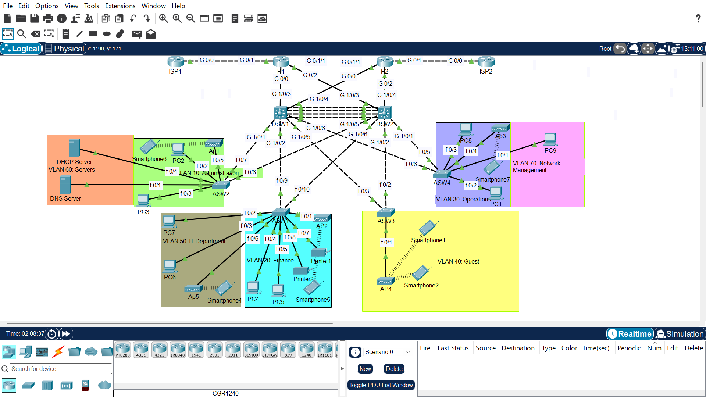

# Project 001: Scalable Small Enterprise Network Design & Implementation

## Project Overview

This project is a small enterprise network designed and built using Cisco Packet Tracer. The network connects different departments, servers, and network devices in one reliable and secure environment.

The design uses two internet service providers to provide internet connectivity and backup in case the primary connection fails. It also uses two distribution switches to improve network availability and reduce downtime.

The project includes VLANs, inter-VLAN routing, OSPF, HSRP, DHCP, DNS, NAT/PAT, and basic network security. The network is designed to support the current needs of a small organization while allowing room for future growth.

This project demonstrates my practical networking skills, network design knowledge, configuration, troubleshooting, and verification.

## Project Goals

The main goals of this project are:

- Connect different departments in one network.
- Separate departments using VLANs.
- Allow devices in different VLANs to communicate where required.
- Provide internet access through two ISPs.
- Use ISP1 as the primary connection and ISP2 as backup.
- Improve network reliability using two distribution switches.
- Provide network services such as DHCP and DNS.
- Protect the network using basic security features.
- Make the network easy to expand as the organization grows.

## Project Ownership

This is my own independent networking project, designed and built by me using Cisco Packet Tracer. It is different from the guided CCNA labs in this repository, where I followed lessons and instructions to practise networking concepts. For this project, I made my own design decisions, built the network, configured the devices, tested the connectivity, and worked through the challenges independently.

## Network Topology and Devices

The network is built using a hierarchical design with edge routers, distribution switches, and access switches.

The topology includes:

- **Two ISPs:** ISP1 is the primary internet connection, while ISP2 provides backup.
- **Two edge routers:** R1 connects to ISP1, and R2 connects to ISP2. Both routers connect to the two distribution switches.
- **Two distribution switches:** DSW1 and DSW2 provide inter-VLAN routing and help improve network availability.
- **Four access switches:** ASW1, ASW2, ASW3, and ASW4 connect end devices to the network.
- **Servers:** A DHCP server provides IP addresses to clients, while a DNS server provides name resolution.
- **End devices:** PCs, printers, and wireless access points are connected through the access switches.

The access switches have uplinks to both distribution switches. This provides an alternative path if one distribution switch or uplink becomes unavailable.

The network uses VLANs to separate departments and network services. Routing between VLANs is handled by the distribution switches.

The topology is designed to provide reliable connectivity, support the current needs of a small organization, and allow future expansion.

## Network Topology

## VLANs and IP Addressing

The network uses VLANs to logically separate departments, servers, and management traffic. Each VLAN has its own IP subnet and default gateway.

| VLAN | Name | Network | Default Gateway |
|---|---|---|---|
| 10 | Administration | 172.16.4.0/25 | 172.16.4.1 |
| 20 | Finance | 172.16.5.128/26 | 172.16.5.129 |
| 30 | Operations | 172.16.4.128/25 | 172.16.4.129 |
| 40 | Guest Wi-Fi | 172.16.5.0/25 | 172.16.5.1 |
| 50 | IT | 172.16.5.192/26 | 172.16.5.193 |
| 60 | Servers | 172.16.6.0/27 | 172.16.6.1 |
| 70 | Management | 172.16.6.32/27 | 172.16.6.33 |
| 999 | Parking VLAN | No IP address | N/A |

## Routing and WAN

The network uses OSPF Area 0 to exchange routing information between the edge routers and distribution switches.

### OSPF
- OSPF is configured in Area 0.
- R1 and R2 establish OSPF adjacencies with DSW1 and DSW2.
- DSW1 and DSW2 exchange routing information over a Layer 3 EtherChannel.
- Internal VLAN networks are advertised through OSPF.

### Internet Connectivity
- ISP1 is the primary internet connection through R1.
- ISP2 provides backup connectivity through R2.
- Both edge routers connect to both distribution switches.
- OSPF default routes are used to direct traffic toward the internet.
- NAT/PAT translates internal private addresses for external connectivity.

### Redundancy and Failover
The network is configured to prefer ISP1 during normal operation. If the primary ISP connection becomes unavailable, the network can use ISP2 as the backup path.

Failover is verified by testing connectivity through the primary connection, temporarily disabling it, and confirming that traffic can use the backup connection.

## Network Services

The network provides centralized DHCP and DNS services to support client connectivity and name resolution.

### DHCP
- A dedicated DHCP server provides dynamic IP addressing to client devices.
- DHCP scopes are configured for the departmental VLANs.
- Default gateways and DNS server addresses are provided through DHCP.
- DHCP relay is configured on the distribution switches to forward client requests to the DHCP server.

### DNS
- A dedicated DNS server provides name resolution for the network.
- Internal DNS records are configured for network services.
- Clients use the DNS server address provided through DHCP.

### Server Network
The DHCP and DNS servers are connected to the server VLAN, which is separated from user and management traffic.

## Network Security

The network implements basic Layer 2 and Layer 3 security measures to reduce unauthorized access and improve network reliability.

### VLAN Segmentation
- Departments are separated into dedicated VLANs.
- The Guest VLAN is isolated from internal departmental networks.
- The Server VLAN is separated from user and management traffic.

### Switch Security
- Unused switch ports are assigned to VLAN 999 and administratively disabled.
- Port security with sticky MAC addresses is enabled on selected end-device ports.
- PortFast and BPDU Guard are configured on appropriate edge ports.
- DHCP snooping is enabled to help protect against unauthorized DHCP servers.

### Access Control
Access Control Lists (ACLs) are used to restrict Guest VLAN access to internal network resources while permitting required services and external connectivity.

### Security Improvements
Dynamic ARP Inspection was considered as an additional security feature, but it was not implemented due to Packet Tracer limitations.

## Redundancy and High Availability

The network uses redundant devices and links to reduce single points of failure and improve availability.

### Distribution Layer
- DSW1 and DSW2 provide redundant Layer 3 distribution.
- A Layer 3 LACP EtherChannel connects the two distribution switches.
- Access switches have uplinks to both distribution switches.

### Gateway Redundancy
HSRP is configured on the distribution switches to provide virtual default gateways for the departmental VLANs.

If the active distribution switch becomes unavailable, the standby switch can take over the virtual gateway role.

### WAN Redundancy
- ISP1 is the preferred WAN connection.
- ISP2 is configured as the backup connection.
- OSPF routing allows the network to use the backup path when the primary path is unavailable.

### Spanning Tree
Rapid PVST+ is configured to prevent Layer 2 loops while allowing redundant links to remain available as alternate paths.

## Testing and Verification

The network was tested in Cisco Packet Tracer to verify connectivity, routing, redundancy, and network services.

### Connectivity Tests
- Verified connectivity between end devices and their default gateways.
- Verified inter-VLAN communication where permitted.
- Verified connectivity between network devices using ping.
- Tested access to simulated ISP loopback addresses.

### Routing Tests
- Verified OSPF neighbor relationships.
- Verified OSPF-learned internal routes.
- Verified that ISP1 is preferred during normal operation.
- Verified that ISP2 can provide the backup path.

### Network Services Tests
- Verified that clients receive IP addresses through DHCP.
- Verified that DHCP relay forwards requests from client VLANs.
- Verified internal DNS name resolution.

### Redundancy Tests
- Verified HSRP gateway operation.
- Verified distribution-switch redundancy.
- Tested EtherChannel link resilience.
- Verified that Rapid PVST+ maintains loop-free Layer 2 connectivity.

## Design Decisions and Packet Tracer Limitations
